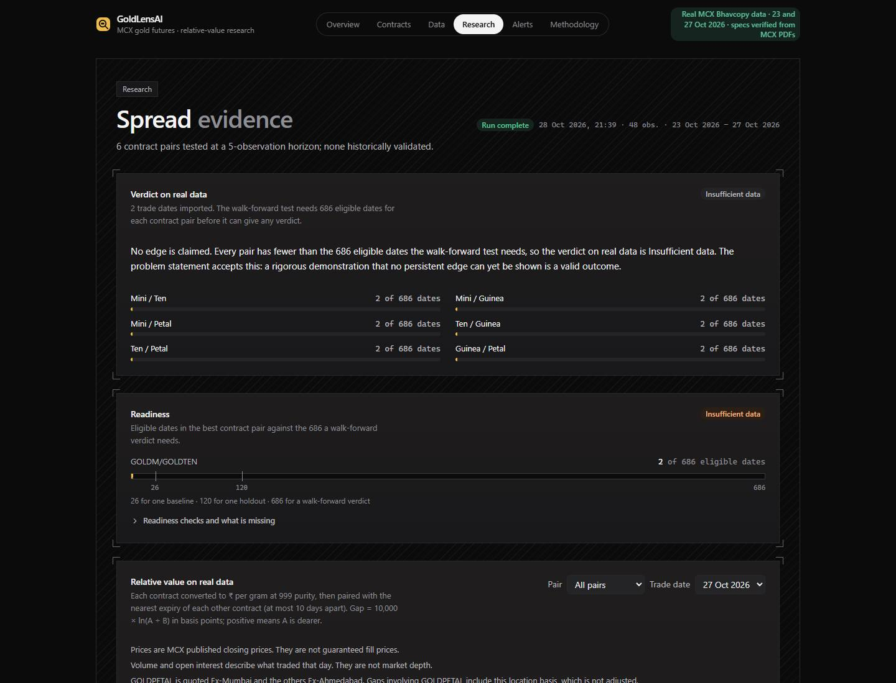
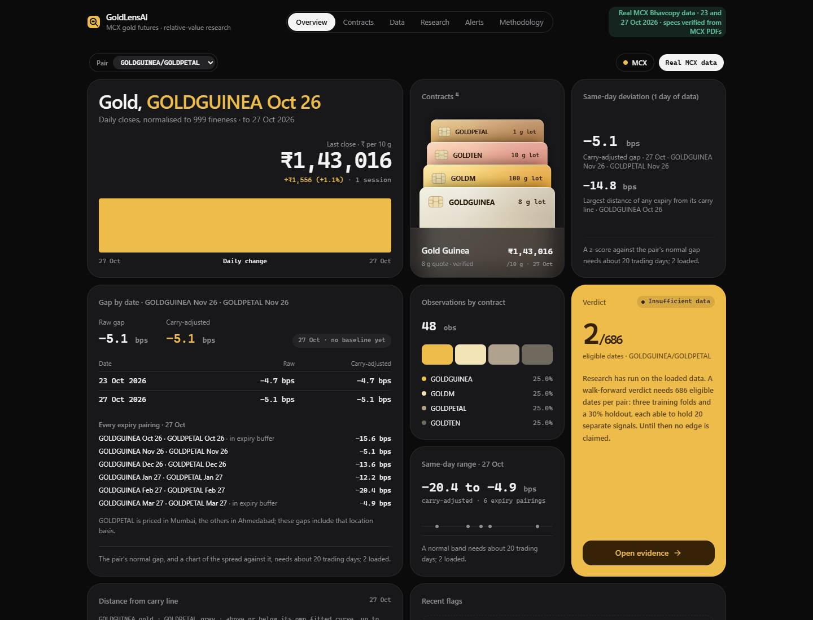
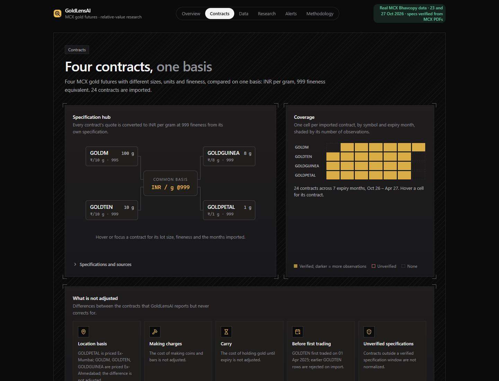
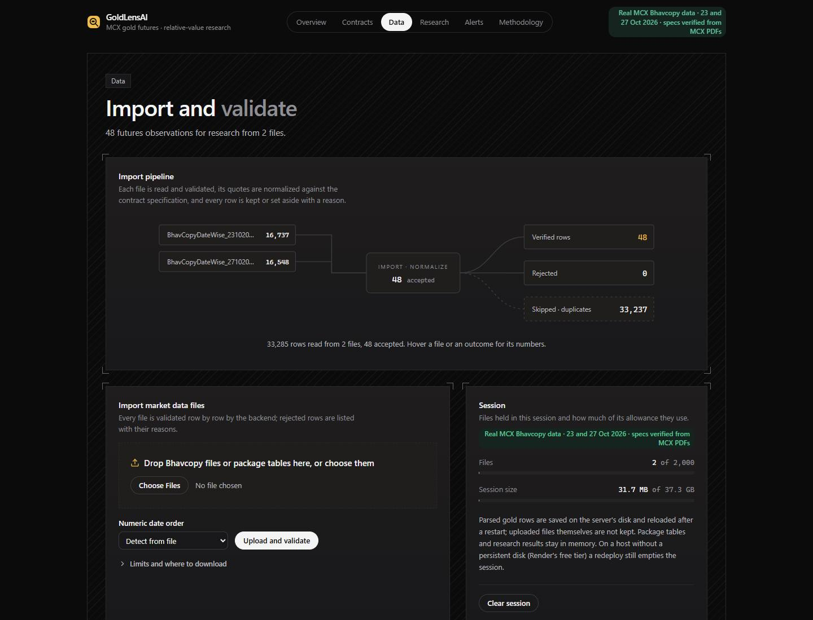
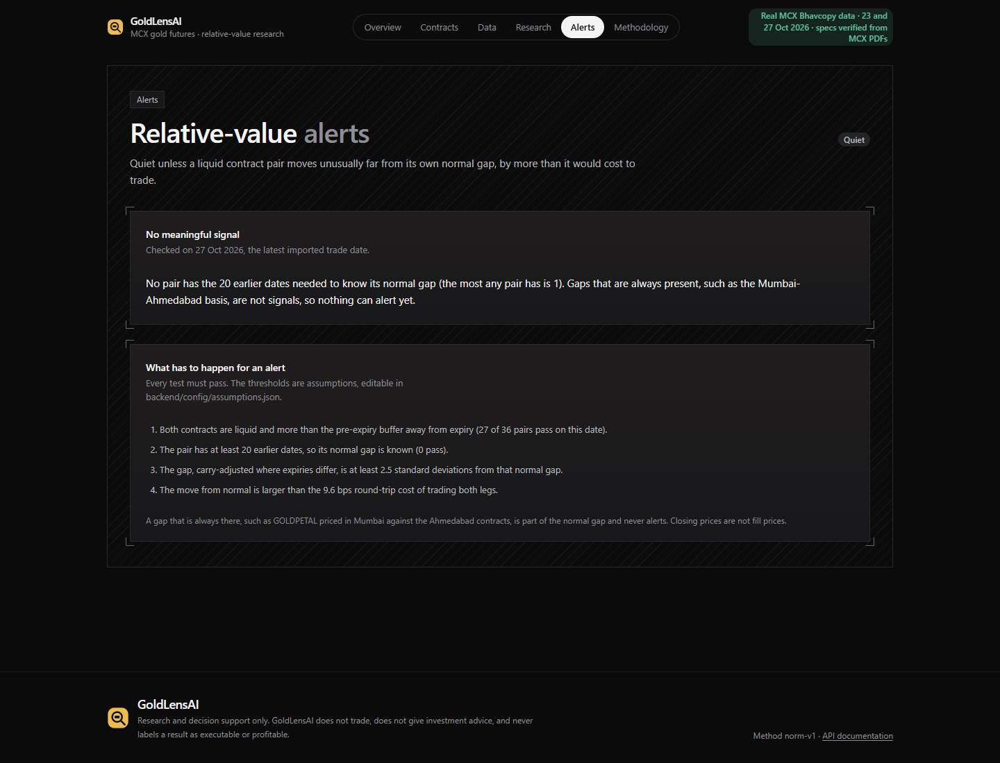
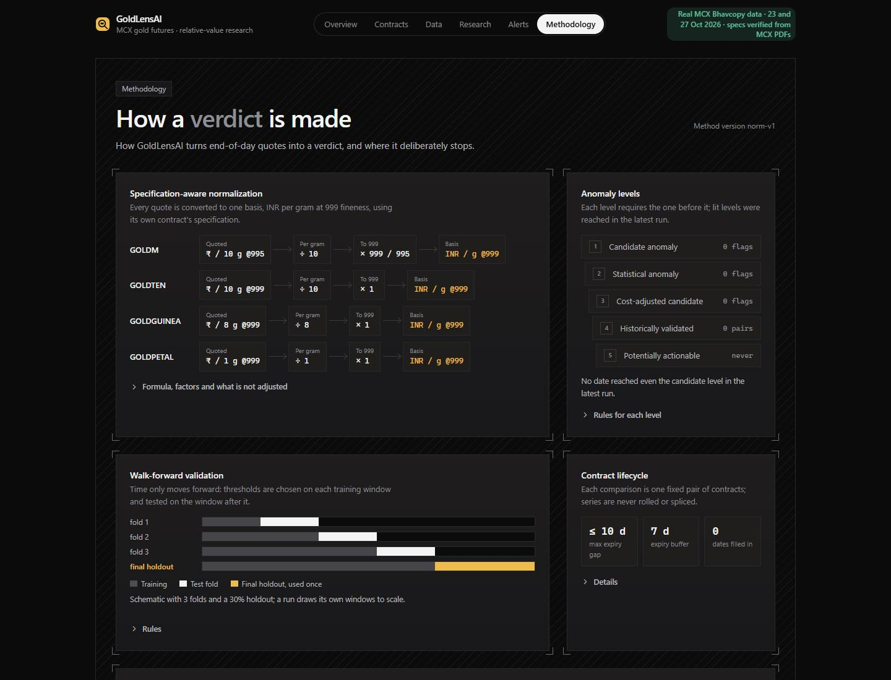

# Gold Lens

**Live:** https://goldlensai.onrender.com (Render free plan: the first visit after a quiet spell
can take about a minute while the server wakes up.)

**Code:** https://github.com/Parth121105/GoldLensAI

Relative-value research on MCX gold futures: GOLDM, GOLDTEN, GOLDGUINEA and GOLDPETAL.
Research and decision support only. It does not trade and is not investment advice.



## The problem

MCX lists four gold futures that are the same metal but are not directly comparable. They
differ in contract size (100 g, 10 g, 8 g, 1 g), quote unit (per 10 g, 8 g or 1 g), purity
basis (995 or 999), price location (Ahmedabad, or Mumbai for GOLDPETAL) and expiry day. The
task: normalize them, measure relative pricing differences and carry, test whether any
difference is a tradeable edge after costs and on unseen data, and say so honestly if not.

## Approach

1. **Normalization.** Every closing price is converted to ₹ per gram at 999 purity using the
   official MCX specification for that contract and expiry (15 specification PDFs,
   transcribed and versioned). Contracts outside a verified specification are refused.
2. **Relative value.** Each contract is paired with the nearest expiry of each other contract.
   Gap = 10,000 × ln(A ÷ B) in basis points, shown next to volume and open interest.
3. **Carry adjustment.** Each contract's futures curve (log price against days to expiry) is
   fitted per day. Its slope is the carry. Gaps between different expiries are shown raw and
   with the carry over the expiry difference removed. Day-to-day moves are split into gold
   move, roll-down, curve change and residual.
4. **Signal.** A z-score of each fixed pair's gap against its own trailing baseline, using only
   earlier dates. Until a pair has about 20 trading days, the app shows what the loaded days
   support on their own (carry-adjusted gaps and each expiry's distance from its carry line)
   and says what more data unlocks.
5. **Walk-forward with no look-ahead.** Parameters are chosen on training windows only (three
   folds), then tested once on a final 30% holdout. Outcomes never cross into a later window,
   and signal events never overlap. On real data it runs automatically at startup and after
   every upload, with the default horizon and the assumed costs.
6. **Cost gating.** A deviation counts only if it beats the round-trip cost of trading both legs.
   Costs, liquidity limits and alert thresholds are editable assumptions in
   [`backend/config/assumptions.json`](backend/config/assumptions.json).

Details: [docs/methodology.md](docs/methodology.md). Limits: [docs/limitations.md](docs/limitations.md).

## Data used, and its limits

| Data | Source | Used for |
|---|---|---|
| Bhavcopy for 23 and 27 Oct 2026 | MCX date-wise download (HTML table saved as `.xls`) | 48 gold futures rows: 4 contracts × 6 expiries × 2 days |
| 15 contract specification PDFs | MCX, "contract onwards" documents for GOLD, GOLDM, GOLDTEN, GOLDGUINEA, GOLDPETAL | Units, purity, location, expiry rules, tender period, making charges |
| Year-wise volume and value, 2005–2026 | MCX gold data package, table A2 | Liquidity history per contract |

Two trading days is far too little for a statistical verdict. Prices are closing prices, not
fill prices, and volume is not market depth. Specifications cover expiries from early 2025
to mid 2027 only.

## Key results

- **Relative value (real data, 27 Oct 2026):** same-expiry gaps run from −37 to −5 bps. For
  example, GOLDTEN against GOLDPETAL (November) is −34.8 bps, part of which is the
  Mumbai–Ahmedabad location difference. GOLDM against GOLDTEN (the two nearest expiry
  pairings) looks like +19 to +26 bps raw, but carry-adjusted it is about +6.3 to +6.8 bps;
  the rest is the expiry difference.
- **Carry:** about 12% a year (12.0–12.7% across contracts and days). A cross-check against the
  raw closing prices gives the same figure to within 0.2 percentage points.
- **Move split, 23 to 27 Oct:** gold moved +148 bps; roll-down about −13 bps; residuals within
  ±11 bps.
- **Lifecycle:** on 27 Oct, the GOLDTEN, GOLDGUINEA and GOLDPETAL October contracts were three
  trading days from expiry, with their tender period starting the next day. GOLDTEN only began
  trading in 2025.
- **Engine check on synthetic data** (clearly labelled, generated in memory, 1,432 days; not
  market data): it caught 84% of injected mispricings (106 of 126), with false alarms on
  0.24% of clean points. Holdout: 166 trades, +21.8 bps per trade before costs and
  **+12.2 bps net** after 9.6 bps round-trip costs, all 6 pairs validated. Correlation with
  the gold price move: 0.00. The control run on the same market with nothing injected finds
  no edge: 0 of 6 pairs validated, −3.8 bps per trade after costs.
- **Verdict on real data:** *Insufficient data.* Each pair has 2 of the 686 eligible dates the
  walk-forward needs. **No edge is claimed.** The problem statement accepts a rigorous "no
  persistent edge shown" as a valid outcome.
- **Alerts:** "No meaningful signal". No pair yet has the 20 earlier dates needed to know its
  normal gap, and persistent gaps such as the location basis never alert.

## Screenshots

| | |
|---|---|
|  |  |
|  |  |
|  |  |

## Tech stack

- **Backend:** Python 3.13+ (deployed on 3.14.8), FastAPI 0.162, Starlette 1.10, Pydantic 2.14,
  Uvicorn 0.54, pytest 9.1
- **Frontend:** Node 24 (deployed on 24.22.1), React 19.3, TypeScript 6.0, Vite 8.3,
  Tailwind CSS 4.3, Motion 14.6, GSAP 3.15, lucide-react 1.62, oxlint 1.89
- **CI:** GitHub Actions runs the backend tests, then the frontend lint and build, on every push
- **Hosting:** one free Render web service ([`render.yaml`](render.yaml)). FastAPI serves the API
  under `/api` and the built frontend at every other path.

## Install and run

You need Python 3.13 or newer and Node 24.

```bash
git clone https://github.com/Parth121105/GoldLensAI.git
cd GoldLensAI

# Backend, on http://localhost:8000
cd backend
python -m venv .venv
.venv/Scripts/activate            # Windows; on macOS/Linux: source .venv/bin/activate
pip install -r requirements-dev.txt
python -m pytest -q               # optional: run the tests
python -m uvicorn app.main:app --port 8000

# Frontend, on http://localhost:5173 (in a second terminal)
cd frontend
npm ci
npm run dev
```

Open http://localhost:5173. The real data is bundled in `backend/data/seed/` and loads the first
time the server starts with an empty store.

To run the production build the way Render does: `bash scripts/render-build.sh` (it also
precomputes the synthetic validation, which takes minutes on Render's free CPU), then
`cd backend && python -m uvicorn app.main:app --port 8000`, and open http://localhost:8000.

## Adding new Bhavcopy files

1. Download the date-wise Bhavcopy from MCX for each trading day. If a requested date is a
   holiday, MCX returns the latest trading day instead; the import warns and keeps the date
   the file states.
2. Put the files in `backend/data/raw/bhavcopy/` (git-ignored).
3. From `backend/`, run `python -m app.cli import-dir data/raw/bhavcopy`. Only the gold futures
   rows are kept and saved to `backend/data/store/`, and a day already held is skipped.
4. Restart the server; research reruns on the new data at startup. You can also upload files
   one at a time on the Data page; those are labelled "User-uploaded · origin unverified".
5. To ship new days with the app, copy the new JSON files from `backend/data/store/` into
   `backend/data/seed/store/` (about 18 KB per day, gold rows only) and commit them. A deploy
   starts with an empty disk and loads the seed folder.

Contract expiries outside the verified specifications are shown but not normalized. To cover
them, add the MCX specification PDF to `backend/data/raw/specs/` and its values to
[`backend/app/specs/mcx_gold_specs.json`](backend/app/specs/mcx_gold_specs.json).

## Licence

MIT. See [LICENSE](LICENSE). Exchange data remains MCX's.

---

Gold Lens normalizes MCX gold contracts, measures relative value and carry on real data, proves its signal engine on controlled data, and refuses to claim an edge until enough real history exists.
